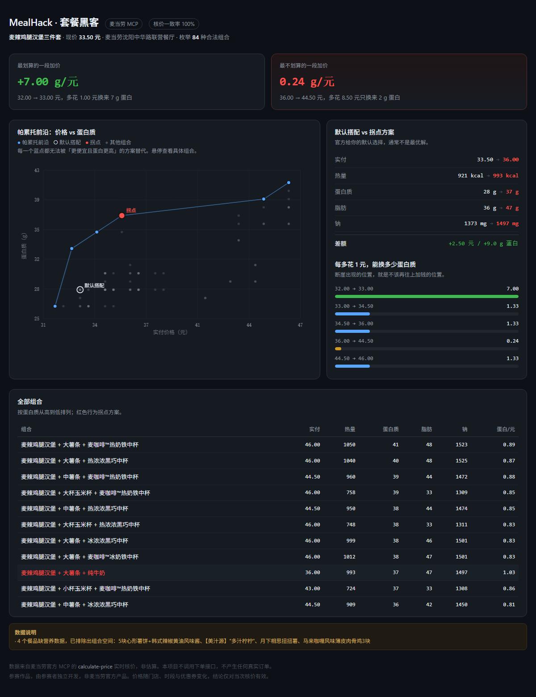

# MealHack · 套餐黑客


**[在线演示](https://yingjun-zheng.github.io/mealhack/)** ·
**[MCP 踩坑记录](MCP_INTEGRATION.md)** ·
**[技术复盘](docs/article.md)** ·
**[60 秒演示脚本](docs/recording-script.md)**

> 官方菜单不会告诉你：一个「麦辣鸡腿汉堡三件套」有 **154 种**合法组合。
> 其中存在一种 —— **便宜 0.5 元、热量少 254 kcal、蛋白质反而多 5g**。
>
> 以上数字全部来自麦当劳官方 `calculate-price` 真实核价，不是估算。
> （剔除 4 个未收录营养数据的新品后，实际参与分析 84 种）

**不改菜单，改结构。**

基于麦当劳 MCP，把「套餐」从一个人只能凭感觉挑的黑箱，还原成一个**可穷举、可核价、可求解的组合空间**。

---

## 为什么做这个

所有人做麦当劳 AI 都在回答同一个问题：*"我该吃什么？"*

但真实菜单里藏着一个没人算过的事实——**套餐里的每一项都是可替换的**。而且替换之后的组合空间，大到人类根本不可能在点餐的 30 秒里穷举完。

更关键的是：**没有人知道官方套餐到底划不划算。** 你默认接受的那套组合，可能既不是最便宜的，也不是营养最优的，甚至不是"东西最多"的。

> 这不是一个推荐工具。推荐是 LLM 拍脑袋就能干的事，而拍脑袋的结果无法验证。
>
> 这是一个**求解器**：它把全部组合算出来，用麦当劳官方的 `calculate-price` 逐一核价，然后告诉你可行域的边界在哪。

---

## 核心洞察

| 常见做法 | 本项目做法 |
|---|---|
| LLM 凭菜单文字"推荐一个搭配" | 穷举全部组合，逐个真实核价 |
| 输出一个答案，无法验证对错 | 输出帕累托前沿，每一点都可被 `calculate-price` 复算 |
| 优化"这一单多少钱" | 优化"同样的钱能换到多少东西" |
| 把套餐当不可分割的商品 | 把套餐当一个带约束的组合优化问题 |

**三句话概括差异：**

1. 套餐不是菜单项，是一个**组合空间**。
2. 划算不是感觉，是一个**可计算的比值**（拆分价值 ÷ 实付价）。
3. 推荐不该给一个答案，该给**一条边界**（帕累托前沿）。

---

## 工作原理

```
① query-meals          拉当前门店全量菜单与套餐
        ↓
② query-meal-detail    解析套餐内每个槽位的可替换项（含加价规则）
   list-nutrition-foods 补齐营养数据（热量 / 蛋白质 / 脂肪 / 钠）
        ↓
③ 组合引擎             笛卡尔积枚举 + 分层采样（组合爆炸时）
        ↓
④ calculate-price      对每个候选组合真实核价（零成本、不下单）
        ↓
⑤ 帕累托前沿           输出"价格 vs 蛋白质"不可支配边界 + 拐点 + 边际收益
```

第 ④ 步是这个项目成立的关键：**`calculate-price` 不下单、不花钱、不占库存**，所以可以对成百上千个组合做真实价格核验。这让"算出来的结论"和"实际付款"之间没有任何缝隙。

---

## 输出长什么样

以下为**真实运行结果**（沈阳中华路联营餐厅 `3230251`，套餐「麦辣鸡腿汉堡三件套」`9900005456`，现价 33.50 元）。

**帕累托前沿：价格 vs 蛋白质**

| 组合 | 实付 | 热量 | 蛋白质 |
|---|---|---|---|
| 麦辣鸡腿汉堡 + 小杯玉米杯 + 可乐中杯 | 32.00 | 685 | 26.0 |
| 麦辣鸡腿汉堡 + 小杯玉米杯 + 纯牛奶 | 33.00 | 667 | 33.0 |
| 麦辣鸡腿汉堡 + 中薯条 + 纯牛奶 | 34.50 | 903 | 35.0 |
| 麦辣鸡腿汉堡 + 大薯条 + 纯牛奶 | 36.00 | 993 | 37.0 |
| 麦辣鸡腿汉堡 + 中薯条 + 麦咖啡热奶铁 | 44.50 | 960 | 39.0 |
| 麦辣鸡腿汉堡 + 大薯条 + 麦咖啡热奶铁 | 46.00 | 1050 | 41.0 |

*每一点都无法被「更便宜且蛋白更高」的方案替代。*

**默认搭配 vs 拐点方案**

| | 实付 | 热量 | 蛋白质 |
|---|---|---|---|
| 默认（中薯条 + 可乐中杯） | 33.50 | 921 | 28.0 |
| 拐点（大薯条 + 纯牛奶） | 36.00 | 993 | 37.0 |
| 差额 | +2.50 | +72 | **+9.0** |

**边际收益：加钱到底划不划算**

| 价格区间 | 多花 | 蛋白增加 | 每元换蛋白 |
|---|---|---|---|
| 32.00 → 33.00 | +1.00 | +7.0 | **7.00** |
| 33.00 → 34.50 | +1.50 | +2.0 | 1.33 |
| 34.50 → 36.00 | +1.50 | +2.0 | 1.33 |
| 36.00 → 44.50 | +8.50 | +2.0 | 0.24 ← 加钱不划算了 |

最后这张表才是这个工具真正的价值：它不只告诉你选什么，还告诉你**再往上加钱会发生什么**。

拐点用**最大弦距法**计算（前沿两端连线，离弦最远的点），而不是"离理想点最近"——后者会偏向保守端，实测会在一个价格跨度 15 元的套餐里挑出最贵的方案。

---

## 交互式可视化



`docs/index.html` 是一个**自包含单文件**：数据内嵌、零外部依赖、零 CDN，双击就能打开，也可以直接挂 GitHub Pages。

- 悬停散点可查看该组合的完整营养数据
- 蓝线是帕累托前沿，白圈是官方默认搭配，红点是拐点
- 右侧直接给出「默认 vs 拐点」的逐项差额

在线版：`https://yingjun-zheng.github.io/mealhack/`（需在仓库 Settings → Pages 把 Source 设为 `docs/`）

---

## 三个可直接使用的场景

**1. 减脂但不饿**
给定热量上限，求蛋白质最高的组合。不需要"少吃点"这种废话，只要一个具体订单。

**2. 增肌不花冤枉钱**
按「每元蛋白质」排序，找出单位成本最优的搭配。

**3. 硬约束求解**
"蛋白质 ≥ 45g、热量 ≤ 1100 kcal、总价 ≤ 26 元"——同时满足的最便宜方案。
**无解时会明确说无解**，而不是编一个凑数的。

---

## 使用的 MCP 工具

| Tool | 用途 |
|---|---|
| `query-nearby-stores` | 定位门店，拿到 store code |
| `query-meals` | 拉取当前可售菜单与套餐 |
| `query-meal-detail` | 解析套餐槽位与可替换项 |
| `list-nutrition-foods` | 补齐营养数据 |
| `calculate-price` | **核心**：对组合真实核价 |
| `query-store-coupons` | 叠加门店优惠券后再核价 |
| `now-time-info` | 判断当前餐段（早餐 / 正餐），不同餐段菜单不同 |

> 本项目只做**查询与核价**，不调用 `create-order`。理论上不会产生任何真实订单。

---

## 快速开始

```bash
# 1. 申请 MCP Token
#    https://open.mcd.cn/mcp → 手机号登录 → 控制台 → 激活

# 2. 配置
export MCD_MCP_TOKEN="your_token_here"

# 3. 探测能力（列出全部 tool 与 schema）
python src/probe.py

# 4. 跑一次求解（同时导出网页所需数据）
python src/solve.py --meal 9900005456 --json docs/data.json

# 5. 生成可视化网页，然后双击 docs/index.html
python src/build_web.py

# 6. 离线验证算法（无 token 也能跑，内置样例数据）
python src/pareto.py
```

零第三方依赖，纯标准库。

---

## 项目结构

```
mealhack/
├── src/
│   ├── mcp_client.py   零依赖 MCP 客户端（Streamable HTTP + SSE + JSON 提取）
│   ├── probe.py        能力探测：dump 全部 35 个 tool schema
│   ├── explore.py      全链路探测：门店 → 菜单 → 套餐详情
│   ├── adapt.py        真实返回 → 标准 Item/Slot/SetMeal（含单位与命名归一化）
│   ├── pareto.py       组合枚举 + 双目标帕累托 + 最大弦距拐点（可离线自测）
│   ├── test_price.py   核价可行性验证：三个极端组合
│   ├── build_web.py    生成自包含可视化网页
│   └── solve.py        CLI 入口
├── skill/              WorkBuddy Skill 封装
├── samples/            真实返回快照（已脱敏，不含 token）
├── docs/               index.html 交互式可视化 + 样例输出
└── MCP_INTEGRATION.md  MCP 调用说明与踩坑记录
```

---

## 局限与诚实声明

- 组合空间受**当前门店实际库存**约束，菜单缺货时部分组合不可得。
- 营养数据来自 `list-nutrition-foods`，为该餐品的标准值，**不等价于特制后的实际值**（去酱、加料会改变营养）。
- 拆分价值使用单品单买价反算，仅供比较参考，**不代表麦当劳的实际成本**。
- 本项目不构成营养或医疗建议。
- 套餐替换规则、加价规则以麦当劳官方实时返回为准。

---

## 参赛说明

麦当劳程序员节创意开发大赛参赛作品，使用 WorkBuddy 开发。
开发对话记录见 [`workbuddy.md`](./workbuddy.md)。
原创性与合规声明见 [`CONTEST_DECLARATION.md`](./CONTEST_DECLARATION.md)。

本项目由参赛者独立开发，非麦当劳官方产品。
